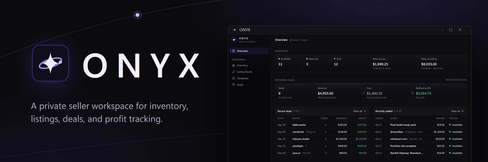
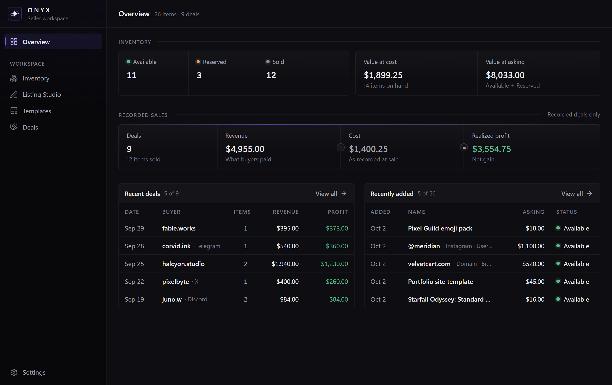
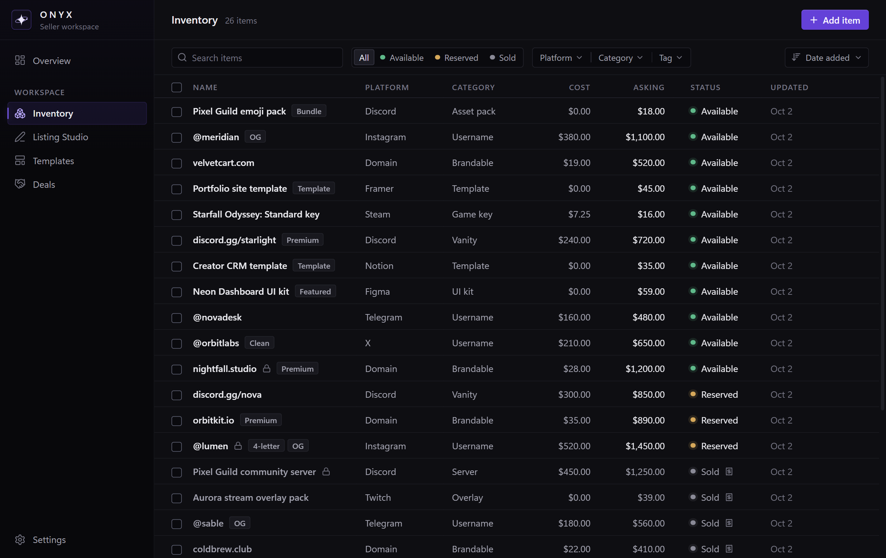
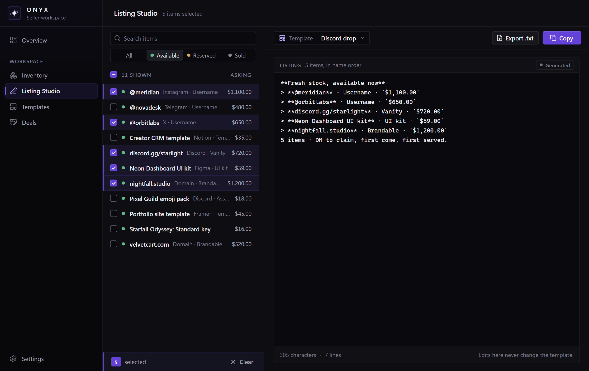
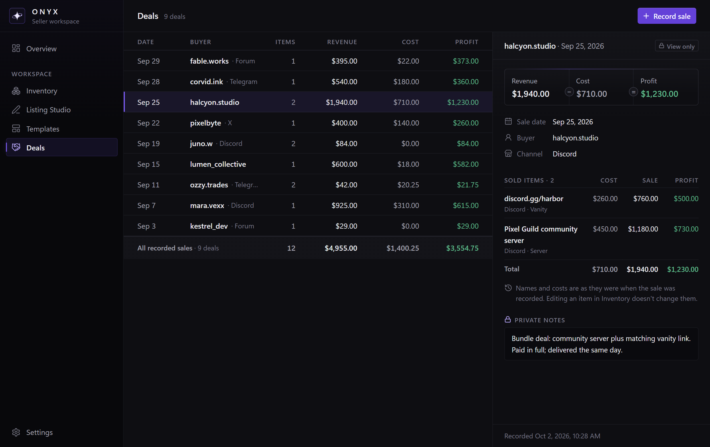

 

**A private desktop workspace for sellers: inventory, listings, deals, and profit, all on your own PC.**

Windows · Private beta · v0.1.0

## What it does

ONYX keeps the whole selling loop in one fast, local app:

**Inventory → Listing → Sale → Profit**

- **Inventory:** track every item's platform, category, cost, asking price, status (available, reserved, sold), tags, and private notes. Search, filter, sort, and update many items at once.
- **Listings:** build reusable plain-text templates with placeholders like `{{name}}` and `{{asking_price}}`. In Listing Studio, pick items, choose a template, and copy the finished listing or export it as `.txt`.
- **Deals and profit:** record what sold, to whom, where, and for how much. Each deal keeps the item costs as they were at the time of sale, so profit stays accurate even if you edit inventory later.
- **Dashboard:** inventory by status, value on hand, recorded revenue and realized profit, recent deals, and recently added items at a glance.

ONYX doesn't post anything for you. You copy the listing and post it yourself, on forums, Discord, Telegram, or anywhere else.

## Screenshots

<table>
  <tr>
    <td width="50%" valign="top">
      <strong>Dashboard</strong> 
      Inventory value and realized profit at a glance.  
      
    </td>
    <td width="50%" valign="top">
      <strong>Inventory</strong> 
      Cost, asking price, status, and tags for every item.  
      
    </td>
  </tr>
  <tr>
    <td width="50%" valign="top">
      <strong>Listing Studio</strong> 
      Pick items, choose a template, copy the listing.  
      
    </td>
    <td width="50%" valign="top">
      <strong>Deals</strong> 
      Revenue, cost, and profit for every recorded sale.  
      
    </td>
  </tr>
</table>

All screenshots use fictional demo data.

## Privacy and security

- **Your seller data stays on your PC.** Inventory, templates, deals, and notes live in a local database on your computer. There's no cloud account and no sync.
- **No marketplace credentials.** ONYX never asks for, stores, or uses marketplace passwords, cookies, session tokens, or account logins.
- **No marketplace connections.** ONYX doesn't connect to any marketplace, forum, or chat app. It never posts, messages, or scrapes anything.
- **Network use is limited to licensing.** ONYX goes online only to activate your license and to check in occasionally. Activation sends your license key and a random ID for this installation. Check-ins send only your signed license. Your seller data is never sent, and there's no telemetry or analytics.
- **Works offline.** After activation, ONYX runs without internet. When you're online, it checks in with the license server about every 14 days.
- **Protected license file.** Your license is stored as a signed license file, encrypted with Windows' built-in data protection for your Windows account. ONYX keeps only the last 4 characters of your key, never the full key.

**Good to know:** your ONYX database isn't encrypted. Anyone who can sign in to your Windows account can open it, so don't store passwords or account logins in item or deal notes. **Settings → Back up…** saves a copy of your data to a file you choose.

## Beta

ONYX is in **private beta**.

- **Invite-only:** beta access and license keys are shared directly with testers.
- **Windows only** for now (64-bit Windows 10 or 11).
- **Up to 2 PCs per key.** Beta keys also have an end date, shown in **Settings → License**.
- **Recorded sales can't be edited or deleted yet**, so check prices before saving a sale.
- **Amounts are in US dollars only.**
- **Updates** come as a new installer. Installing over the old version keeps your data.
- Expect rough edges, and send feedback as you go.

## Installation

You'll get the installer (`ONYX_0.1.0_x64-setup.exe`) and a license key with your beta invite. Only install ONYX from the link in your invite.

1. Run the installer. It installs for your Windows account only, with no admin rights needed.
2. Open ONYX and enter your license key on the activation screen.

**The installer isn't code-signed yet.** Because of that, your browser may warn that the file isn't commonly downloaded, and Windows SmartScreen may say *"Windows protected your PC"* and list the publisher as *Unknown publisher*. If you got the installer from your invite, choose **Keep** in the browser and **More info → Run anyway** in SmartScreen.

You don't need to turn off SmartScreen, your antivirus, or any other protection to install or use ONYX. If your security software blocks it, don't override it; reply to your invite message instead.

Uninstalling ONYX keeps your data and license unless you choose to delete them.

## Contact

For questions, feedback, or problems, reply to your invite message. Please report security issues privately as described in [SECURITY.md](SECURITY.md).

 

ONYX · © 2026 <a href="https://github.com/starboyevan">starboyevan</a> · All rights reserved

